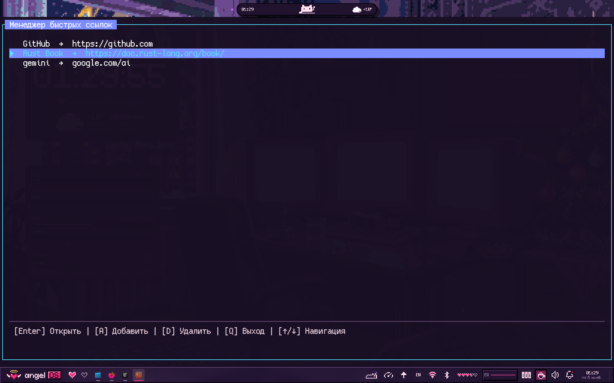
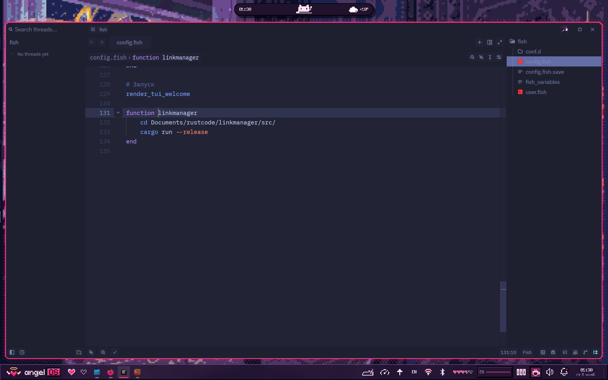
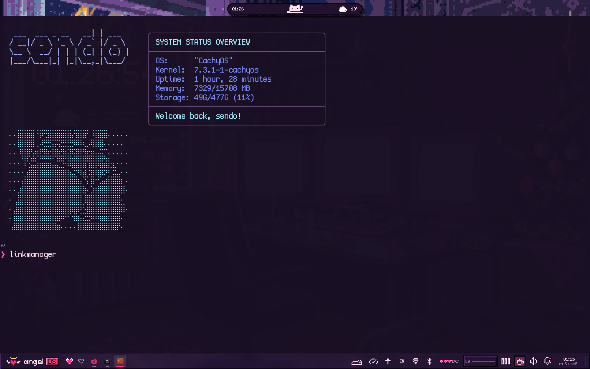

# Короче хочу представить вам мой tui, он очень простой, но все же я старался просто упростить себе жизнь

Суть этого tui проста, просто помогает найти и зайти быстро по какой - либо ссылке

## Для использования данного tui вам понадыбится: установить компилятор раст и все)

 Инструкция по установке:

``` bash
git clone https://github.com/sendox2012-debug/linkmanager/
```
После этого, заходим в конфиги вашего терминала bash/fish, в моем случаи это fish.

Для тех у кого фишь просто берем и копируем функцию, но поменяйте путь до файла с tui 


# После этого берем и просто пользуемся)

